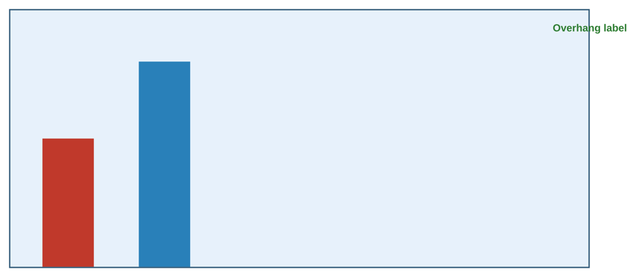

# HTML WYSIWYG Export

Convert HTML pages to **PDF** or **high-resolution PNG** exactly as they look on screen: same colors, nothing cropped off, ready to drop into Word or a slide.



## Why I built it

I needed to put HTML charts and diagrams into Word documents. The converters I tried each failed in a different way: some couldn't handle large pages, some changed or dropped background colors, and some cropped off content near the edges. This utility uses the Chrome or Edge browser already on your computer to render the page, then saves exactly what the browser shows.

## What it does

| Output | What you get | Launcher |
|---|---|---|
| PNG, 600 DPI | Tightly cropped, high-resolution image. Best for Word. | `Convert_HTML_to_600DPI_PNG.cmd` |
| PNG, 300 DPI | Same, at a smaller file size | `Convert_HTML_to_300DPI_PNG.cmd` |
| Exact-size PDF | One page sized to fit the whole HTML page | `Convert_HTML_to_PDF.cmd` |
| Letter PDF | US Letter, landscape, 0.25-inch margins | `Convert_HTML_to_Letter_PDF.cmd` |

- **Exact colors:** backgrounds and colors print as they appear on screen.
- **Smart cropping:** PNG output measures the content *and every element inside it*, so labels or shapes that overhang their container aren't cut off, then adds a safety margin.
- **No large downloads:** it uses your installed Chrome or Edge instead of downloading a separate browser.
- **Batch-friendly:** drag several HTML files onto a launcher at once.

Output files are saved next to each HTML file (for example, `chart.html` becomes `chart_600dpi.png`).

## Requirements

- Windows (the drag-and-drop launchers are `.cmd` files; the script itself also runs on macOS and Linux)
- [Node.js](https://nodejs.org/) 14.14 or later
- Google Chrome or Microsoft Edge

## Install

1. Download or clone this repository.
2. Double-click **`INSTALL.cmd`**. It checks for Node.js and installs the one dependency (`puppeteer-core`).

## Use

Drag one or more `.html` files onto the launcher you want, such as **`Convert_HTML_to_600DPI_PNG.cmd`**.

### Command-line options

```
node html2output.mjs --png --dpi=600 [--pad=14] [--selector=CSS] file1.html [file2.html ...]
node html2output.mjs --pdf-exact file1.html
node html2output.mjs --pdf-letter --landscape file1.html
```

| Option | Meaning | Default |
|---|---|---|
| `--png` / `--pdf-exact` / `--pdf-letter` | Output type | `--pdf-exact` |
| `--dpi=N` | PNG resolution, 96 to 1200 | 600 |
| `--pad=N` | Extra space around a cropped PNG, in pixels (0 to 100) | 14 |
| `--selector=CSS` | Crop the PNG to a specific element, for example `--selector=#chart` | First `<div>` in the page body |
| `--viewport=N` | Browser window width used for layout, in pixels | 2200 |
| `--portrait` / `--landscape` | Orientation for Letter PDF | Landscape |
| `--no-sandbox` | Turns off the browser sandbox. Only needed on Linux when running as root or in a container. | Sandbox on |

To use a browser in a non-standard location, set the `BROWSER_PATH` environment variable to the full path of `chrome.exe` or `msedge.exe`.

## Security note

This tool opens local HTML files in a headless browser with the browser's security sandbox **on** by default. Only convert HTML files you trust, especially if you use `--no-sandbox`.

## How it was built

I designed and tested this utility and built it with AI-assisted development (ChatGPT, then Claude). I set the requirements, tested each version against real documents, and decided what changes to keep.

## Version history

- **1.5.0:** Added `--selector` to choose the crop target. Browser sandbox now stays on by default (`--no-sandbox` is opt-in). Fixed cropping so the right and bottom padding are kept when content sits at the page edge. Pages that never stop loading (live data, slow web fonts, cloud-only files) no longer fail with a timeout; the tool waits a reasonable time, then converts what has rendered. Uses Chrome's current headless mode. Clearer error if the browser can't start.
- **1.4.0:** Cropping now measures the main container *and* all elements inside it; default viewport width raised to 2200 px; default crop padding of 14 px; added `--pad`.

## License

[MIT](LICENSE) © 2026 Les Thomas
